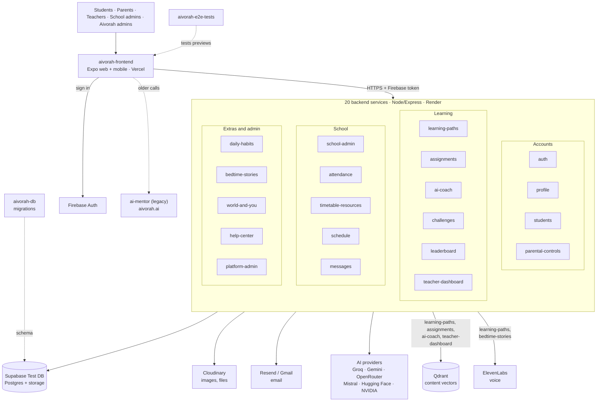

# Architecture

The full picture: the app, the 20 backend services grouped by area, and every data store and outside service they use. Built from the live Render settings and the code on 2026-11-03.

## System diagram

Live notifications go from **messages** back to the app over a WebSocket and Expo push.

## What each service uses

From each service's environment settings on Render.

| Service | Supabase | Firebase | Qdrant | Cloudinary | Email | AI and other |
|---|---|---|---|---|---|---|
| auth | ✅ | ✅ | | | Resend, Gmail | |
| profile | ✅ | | | ✅ | Resend | |
| students | ✅ | ✅ | | | Resend | Groq; calls auth, learning-paths |
| parental-controls | ✅ | | | | | |
| learning-paths | ✅ | ✅ | ✅ | ✅ | | Groq, Gemini, ElevenLabs |
| assignments | ✅ | | ✅ | ✅ | | Groq, Gemini, Mistral, Hugging Face |
| ai-coach | ✅ | | ✅ | | | Groq, NVIDIA |
| challenges | ✅ | | | | | |
| leaderboard | ✅ | | | | | |
| teacher-dashboard | ✅ | | ✅ | | | |
| school-admin | ✅ | ✅ | | ✅ | Resend, Gmail | Groq |
| attendance | ✅ | ✅ | | | | |
| timetable-resources | ✅ | ✅ | | ✅ | | Groq, Gemini, OpenRouter |
| schedule | ✅ | ✅ | | | | |
| messages | ✅ | ✅ | | ✅ | | Groq; WebSocket, Expo push |
| daily-habits | ✅ | | | | | |
| bedtime-stories | | | | | | Groq, ElevenLabs |
| world-and-you | ✅ | | | | | Groq, News API |
| help-center | | | | | Gmail | Groq |
| platform-admin | ✅ | ✅ | | | Resend, Gmail | Gemini; calls auth |

Service addresses: [../repositories.md](../repositories.md). Which screens use which service: [FEATURE_SERVICE_MAP.md](FEATURE_SERVICE_MAP.md).
