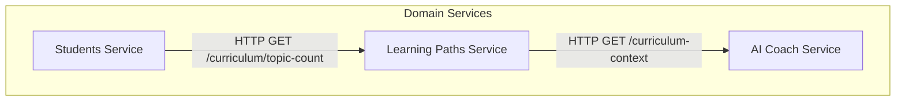

# Service Dependency Map

> Moved from an untracked draft in `aivorah-frontend/docs/architecture/` (written 2026-09-21). Not re-verified since; check the code before relying on it.

## Backend-to-Backend Communication
While most microservices operate independently communicating directly with their own databases, there are a few explicit inter-service API calls:

| Calling Service | Called Service | Endpoint/Capability | Reason | Communication Type | Verified |
| --------------- | -------------- | ------------------- | ------ | ------------------ | -------- |
| `aivorah-learning-paths-service` | `aivorah-ai-coach-service` | `/curriculum-context` | Retrieve grounded AI context during curriculum generation | HTTP `fetch` (via env var) | Yes |
| `aivorah-students-service` | `aivorah-learning-paths-service` | `/curriculum/topic-count` | Calculate available topics for a parent/student | HTTP `fetch` (via env var) | Yes |

## Anti-Patterns Detected
- **Direct Database Sharing**: 
  - Almost all microservices (`aivorah-assignments-service`, `aivorah-students-service`, `aivorah-profile-service`, etc.) connect to the exact same `Supabase` URL and `Qdrant` instance.
  - While they are physically separated by repositories, they are heavily coupled at the database layer. This violates the microservices boundary principle where a service should exclusively own its tables.
  - **Risk**: A schema change in Supabase can break multiple services.

## Dependency Graph

