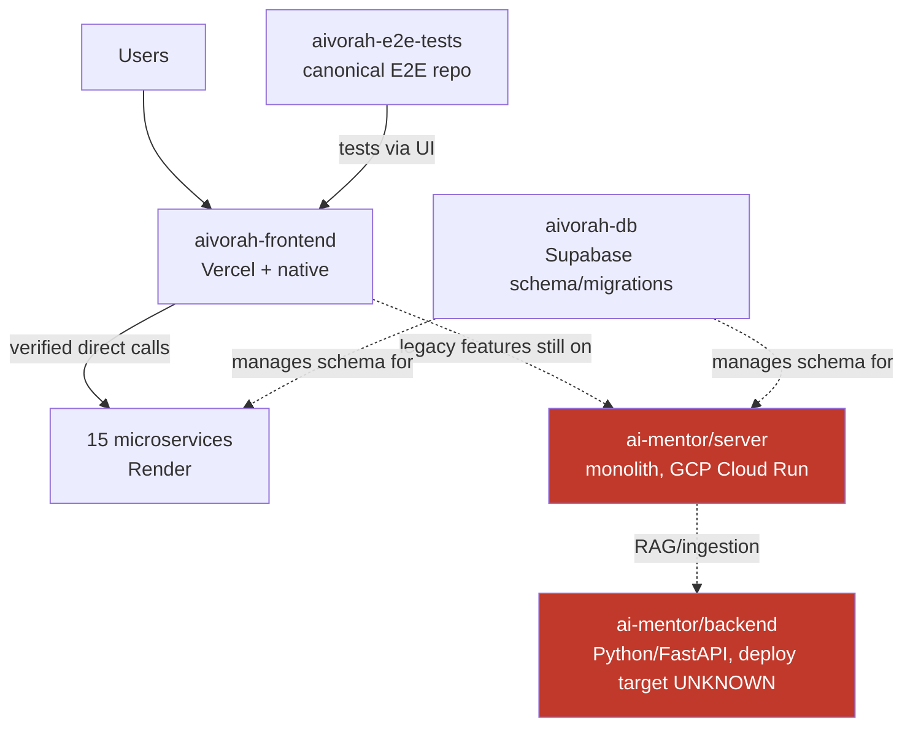

# System Architecture

## High-level diagram

**Frontend directly consumes the 15 microservices where verified** (each via its own `src/config/*ServerUrl.ts`, see `SERVICE_MAP.md`). Service-to-service calls were only sampled (1 of 15 services checked, zero cross-service calls found) — **not exhaustively verified**; treat "microservices don't call each other" as a working hypothesis backed by one data point, not a confirmed fact for all 15.

## Current vs legacy architecture

- **Current (target state):** frontend → dedicated microservice → its own DB access. Each migrated feature has its own `aivorah-*-service` repo.
- **Legacy (still real, still running):** frontend → `ai-mentor/server` monolith. Entire Parent persona, entire School Admin persona, several Teacher sub-features (Challenges, Syllabus Import, Attendance, Help), and most `.legacy-*` screens are 100% monolith-backed as of this writing — see `DATA_FLOW.md`.
- **Migration is feature-by-feature and mid-flight, not finished.** A screen can be fully refactored on the frontend while its backend is still 100% monolith — these are separate axes, don't assume one implies the other.

## Migration/cleanup items (not yet done — do not treat as complete)
1. **E2E consolidation**: `aivorah-frontend/e2e/` (embedded copy, non-canonical) needs reconciling with and removing in favor of `aivorah-e2e-tests` (canonical). Not started.
2. **Monolith mop-up**: several "migrated" features still have residual monolith calls (mixed-backend state) — see `SERVICE_MAP.md`'s per-service dependency notes and `DATA_FLOW.md`.
3. **Parent + School Admin personas**: zero dedicated microservices exist yet for these — 100% monolith. Standing up services for them is a separate, larger future task, not in progress.

## Standing rule: never touch the monolith incidentally
`ai-mentor/server` and `ai-mentor/backend` will eventually be refactored/extracted feature-by-feature — that's the real end goal. What's off-limits is touching either **as a side effect** of unrelated work: no extracting/editing/backend-testing against the monolith while doing a today's frontend task, no reaching into it "just to check something" mid-task. Monolith refactor/extraction happens as its own dedicated, planned step (e.g. "extract Teacher Dashboard's 3 endpoints"), never folded into unrelated work.

## Known extraction precedent (for pattern reference)
Teacher Dashboard was fully extracted (2026-08-24) from `ai-mentor/server/routes/student.js` into `aivorah-teacher-dashboard-service` — 3 routes (`/student/by-teacher/:teacherId`, `.../insights`, `.../recent-activity/by-teacher/:teacherId`), with a backend test convention of top-level `tests/unit/`+`tests/integration/` per microservice repo (vs. frontend's colocated `__tests__/unit/`+`__tests__/integration/` per feature folder). Use this as the template for future extractions.

## Test/refactor work order convention (frontend features)
For each feature: **E2E (safety net) → Refactor (frontend, if not done) → Unit + Integration tests (on the now-isolated pieces) → Coverage report.** Backend unit tests only apply once a feature's backend is confirmed migrated (has its own service repo).
