# Aivorah System Architecture

> Moved from an untracked draft in `aivorah-frontend/docs/architecture/` (written 2026-09-21). Not re-verified since; check the code before relying on it.

More detailed than `SYSTEM_ARCHITECTURE.md` (2026-08-31 summary).

## Overview
Aivorah is transitioning from a monolithic Express backend (`ai-mentor`) to a modern, domain-driven microservices architecture.
Currently, the system is in a **hybrid state**. Most domain features have dedicated microservices (e.g., Auth, Profile, Students, Assignments, Leaderboard), but a substantial number of legacy features, as well as several core routing paths for new features, still depend on the Legacy Monolith.

## Architecture Diagram

```mermaid
flowchart TD

    subgraph CLIENTS["Clients"]
        Student["Student UI"]
        Parent["Parent UI"]
        Teacher["Teacher UI"]
        SchoolAdmin["School Admin UI"]
    end

    subgraph FRONTEND["Aivorah Frontend (React Native / Expo)"]
        WebApp["Web / Native App"]
        APIClient["API Config & Clients"]
    end

    subgraph SERVICES["Domain Microservices (Migrated)"]
        Auth["Auth Service"]
        Students["Students Service"]
        Profile["Profile Service"]
        Assignments["Assignments Service"]
        Challenges["Challenges Service"]
        LearningPaths["Learning Paths Service"]
        Schedule["Schedule Service"]
        Messages["Messages Service"]
        Leaderboard["Leaderboard Service"]
        DailyHabits["Daily Habits Service"]
        BedtimeStories["Bedtime Stories Service"]
        AICoach["AI Coach Service"]
        World["World and You Service"]
        TeacherDash["Teacher Dashboard Service"]
        AdminDash["School Admin Dashboard Service"]
        AdminSvc["School Admin Service"]
        ParentalControls["Parental Controls Service"]
        HelpCenter["Help Center Service"]
    end

    subgraph LEGACY["Legacy"]
        Monolith["AI Mentor (Monolith)"]
    end

    subgraph DATA["Data Layer"]
        Supabase[(Supabase / Postgres)]
        Qdrant[(Qdrant Vector DB)]
        Firebase[(Firebase Auth)]
    end

    subgraph EXTERNAL["External AI & Storage Services"]
        Groq["Groq"]
        Gemini["Gemini / NVIDIA NIM"]
        Cloudinary["Cloudinary"]
        ElevenLabs["ElevenLabs"]
    end

    %% Client to Frontend
    Student --> WebApp
    Parent --> WebApp
    Teacher --> WebApp
    SchoolAdmin --> WebApp
    WebApp --> APIClient

    %% Frontend to Microservices
    APIClient --> Auth
    APIClient --> Students
    APIClient --> Profile
    APIClient --> Assignments
    APIClient --> Challenges
    APIClient --> LearningPaths
    APIClient --> Messages
    APIClient --> Leaderboard
    APIClient --> DailyHabits
    APIClient --> BedtimeStories
    APIClient --> AICoach
    APIClient --> World
    APIClient --> TeacherDash
    APIClient --> AdminDash
    APIClient --> AdminSvc
    APIClient --> ParentalControls
    APIClient --> HelpCenter

    %% Frontend still relies heavily on Monolith
    APIClient -.->|Legacy UI & Routing| Monolith

    %% Microservices to DBs
    Auth --> Supabase
    Auth --> Firebase
    Students --> Supabase
    Students --> Firebase
    Profile --> Supabase
    Assignments --> Supabase
    Assignments --> Qdrant
    LearningPaths --> Supabase
    LearningPaths --> Qdrant
    Leaderboard --> Supabase
    Leaderboard --> Qdrant
    AICoach --> Supabase
    AICoach --> Qdrant
    TeacherDash --> Supabase
    TeacherDash --> Qdrant
    AdminDash --> Supabase
    AdminDash --> Qdrant
    
    %% Other MS DB connections
    Challenges --> Supabase
    DailyHabits --> Supabase
    Messages --> Supabase
    ParentalControls --> Supabase
    Schedule --> Supabase
    AdminSvc --> Supabase
    World --> Supabase

    %% Legacy Monolith to DBs
    Monolith --> Supabase
    Monolith --> Qdrant

    %% Microservices to External APIs
    AICoach --> Groq
    LearningPaths --> Groq
    LearningPaths --> Cloudinary
    Assignments --> Groq
    Assignments --> Gemini
    Assignments --> Cloudinary
    Profile --> Cloudinary
    AdminSvc --> Cloudinary
    Messages --> Cloudinary
    BedtimeStories --> ElevenLabs
    BedtimeStories --> Groq
    World --> Groq
    Students --> Groq
    AdminSvc --> Groq
    HelpCenter --> Groq
```

## Architectural State
While many microservices have been provisioned and integrated into the frontend (`SERVER_URL` replaced by domain-specific variables like `ASSIGNMENTS_SERVER_URL`), the **legacy monolith remains heavily utilized**. The frontend still queries the monolith for curriculum prefetching, legacy 5E learning screens, timetable and class portfolio management.

In some cases, a service exists (e.g., `aivorah-schedule-service`) but the frontend still queries the monolith for schedule data (`fetchUpcomingDeadlines` using `SERVER_URL`).
