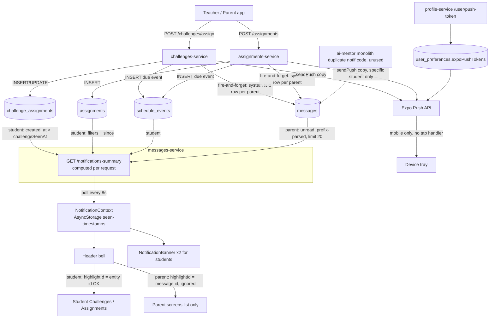

# Notification System Audit (2026-09-24)

> Moved from an untracked draft in `aivorah-frontend/docs/architecture/` (written 2026-09-24). Not re-verified since; check the code before relying on it.

Read-only audit. No code was changed for this audit.

**How to read the line numbers:** they refer to the working tree today. That tree includes the uncommitted Challenge bug fixes from the previous session, which are marked **[uncommitted fix]**. Everything else describes what is live on Vercel and Render today.

Repos involved: `aivorah-frontend`, `aivorah-messages-service`, `aivorah-challenges-service`, `aivorah-assignments-service`, `aivorah-profile-service`, `aivorah-db`, and `ai-mentor/server`. The monolith only matters here as a set of dead duplicate copies.

---

## 1. Executive Summary

- **Aivorah has no notification system and no notification table.** The bell, the toast and the badge are *computed on every poll* by `GET /messages/notifications-summary` in aivorah-messages-service. It rebuilds them each time from five domain tables (`assignments`, `challenge_assignments`, `schedule_events`, `parent_daily_tasks`, `messages`).
- **Students and parents use two completely different mechanisms.**
  - *Students:* the service reads the domain tables directly, for example `challenge_assignments.created_at > challengeSeenAt`.
  - *Parents:* the creating service inserts a fake chat message (`sender_email = system@aivorah.com`, `content = 'New Challenge assigned: "…"'`). messages-service later recognises that text by its prefix and parses it back out.
  - Because the paths are separate, they can diverge. The parent can have a real record while the student has only a derived one, or none at all.
- **Read/unread state is not stored per notification.**
  - Students: a single timestamp per category in the device's AsyncStorage (`challengeSeenAt_v2_<email>`). The value comes from the **device clock**.
  - Parents: `messages.read_at`, which gets bulk-updated.
  - Result: tapping one notification clears every notification in that category.
- **Push (Expo) is mobile-only and has no tap handler.** Pushes are sent, but tapping one does not deep-link anywhere. The web app, which is what testers use, never gets push notifications.
- **Parent deep links cannot work.** Parent bell items carry the *message id* as `highlightId`, and `ParentChallenges`/`ParentAssignments` never read `highlightId`.
- The root causes of the three bugs the tester reported are in §17. Beyond those, the audit found **12 more verified defects** that explain the "sometimes works, sometimes doesn't" behaviour (§16–§20).

---

## 2. Current Notification Architecture

There are four independent channels. They share no ID, no record and no status:

| Channel | Where it is produced | Where it is read | Persistent? |
|---|---|---|---|
| In-app bell list | Computed per request in messages-service `notifications-summary` | `NotificationContext` poll every 8 s → `Header.tsx` | No (students), partly (parents, as chat rows) |
| In-app toast | Client-side diff between polls (`NotificationContext.poll`) | `NotificationBanner.tsx` | No |
| Badge count | Same summary response (`messages/assignments/challenges/events` counts) | `Header.tsx` | No |
| Mobile push | `services/push.js`, the **same file copied into 4 services** (challenges, assignments, messages, daily-habits) | OS tray. The app has no tap listener. | No (fire and forget) |

- **Email:** not used for assignment or challenge notifications. `mailer.js` in the auth and profile services handles account emails only.
- **Realtime:** a WebSocket (`/messages/realtime`, `services/realtime.js`) exists but carries **only chat messages** (`routes/messages.js:1177`). Notifications never use it.

## 3. Services Involved

| Responsibility | Owner (verified) | Evidence |
|---|---|---|
| Challenge assign + notify | aivorah-challenges-service | `routes/challenges.js:150` `POST /challenges/assign`; `services/challenges.js:112` `notifyChallengeAssigned` |
| Assignment create + notify | aivorah-assignments-service | `routes/assignments.js:981` `POST /assignments`; push at `:1122`; parent message at `:1227` |
| Bell feed, counts, read state | aivorah-messages-service | `routes/messages.js:148` `notifications-summary`; `:493` `mark-read`; `:541` `mark-system-read` |
| Push-token registration | aivorah-profile-service | `routes/profile.js:77` `POST /user/push-token` → `user_preferences.data.expoPushTokens` |
| Push sending | Duplicated `services/push.js` in challenges, assignments, messages and daily-habits | These files are byte-identical apart from one comment |
| Frontend state | `src/context/NotificationContext.tsx` | poll → `notifications-summary` |
| Frontend UI | `src/components/common/Header.tsx` (bell), `src/components/common/NotificationBanner.tsx` (toast) | |
| Push registration (client) | `src/services/pushNotifications.ts`, called from `App.tsx:778` | |
| Monolith | `ai-mentor/server/routes/{messages,challenges,assignments,habits}.js` still have their own `notifications-summary` + `sendPush` | **Not called by the frontend.** Every notification URL goes to a microservice. These are dead duplicates, and their local `.env` points at Prod (`jwlepxmclbkrmfzrumch`). |

## 4. Database Tables

**No `notifications` table exists** (checked in `aivorah-db/supabase/migrations/0001…0005`). Notifications are derived from these tables:

| Table | Role in notifications | Key columns | PK / unique / FK / index |
|---|---|---|---|
| `challenge_assignments` | Student challenge notification source | `id text`, `challenge_id text`, `student_id uuid`, `assigned_by_id text` (email), `assigned_by_role`, `due_date date`, `status`, `created_at timestamptz default now()`; **no `updated_at`** | PK `id`. **No UNIQUE(challenge_id, student_id).** FK student→users CASCADE. Idx on challenge_id and student_id. |
| `assignments` | Student assignment notification source | `id`, `student_id` (null = class-wide), `created_by_id`, `created_by_role`, `grade`, `curriculum`, `type`, `created_at` | PK `id`; FK student, creator; idx student_id, created_by_id |
| `messages` | Chat **and** parent "notifications" (system rows) | `id uuid`, `sender_email`, `recipient_email`, `content text`, `created_at`, `read_at` | PK `id`; idx recipient_email, created_at DESC. **No type, entity_type or entity_id column.** The notification type is encoded in the text of `content`. |
| `schedule_events` | Student "event" notifications, including auto-created due-date events for challenges and assignments | `id`, `student_id` (uuid or `'all'`), `created_by`, `type`, `assignment_id`, `challenge_id`, `created_at` | |
| `parent_daily_tasks` | Student "task" notifications | `id`, `child_id`, `label`, `created_at` | |
| `parent_children` | Parent resolution | `parent_email text`, `child_id uuid` | UNIQUE(parent_email, child_id); idx both |
| `teacher_student` | Class-wide assignment targeting | `teacher_id`, `student_id`, `subject` | PK (teacher_id, student_id, subject). A second table, `teacher_students` (plural), also exists. |
| `user_preferences` | Push tokens + notification toggles | `user_email`, `data jsonb` (`expoPushTokens[]`, `assignmentAlerts`, `challengeUpdates`, `teacherMessages`) | |

The notification-related fields you asked about (entity_type, entity_id, deep-link route, per-item read_at, payload) **do not exist anywhere**. Deep-link targets are rebuilt from item `type` + `id` on the client.

## 5. Notification Creation Flow (all paths)

| Event | Service | Function | Recipient | "Type" | Where stored | Delivery |
|---|---|---|---|---|---|---|
| Challenge assigned | challenges | `notifyChallengeAssigned` (`services/challenges.js:112`) | Student | push `data.type='challenge'` | nothing (push only) | Expo push if token + `challengeUpdates≠false` |
| Challenge assigned | challenges | same | Student (bell) | derived `challenge` | `challenge_assignments` row itself | poll, if `created_at > challengeSeenAt` |
| Challenge assigned | challenges | same | Parent (push) | same push call | — | Expo push |
| Challenge assigned | challenges | same, 2nd try-block | Parent (bell) | `messages` text `New Challenge assigned: "…"` | `messages` | poll, while `read_at IS NULL` |
| Challenge due date | challenges | `/assign` route `:238` | Student (bell) | derived `event` (srcType challenge) | `schedule_events` | poll → **2nd bell item for the same assign** |
| Assignment created (specific student) | assignments | inline `:1122` | Student + Parent (push) | push `data.type='assignment'` | — | Expo push |
| Assignment created | assignments | — | Student (bell) | derived `assignment`/`quiz` | `assignments` row | poll, if `created_at > assignmentSeenAt` |
| Assignment created | assignments | `notifyParentsOf` `:1227` | Parent (bell) | `messages` text `New Assignment/Quiz assigned: "…"` | `messages` | poll |
| Assignment created (class-wide) | assignments | — | Students | **no push at all** (`if (userId)` guard) | derived | poll with curriculum/grade/school/teacher filters |
| Assignment created (class-wide) | assignments | `notifyParentsOf` via `teacher_student` + grade | Parents | message | `messages` | poll |
| Assignment due date | assignments | `:1197` | Student (bell) | derived `event` (`deadline`) | `schedule_events` | poll → **2nd bell item** |

**More than one system can create the same notification:**
- The monolith has parallel copies. The frontend doesn't call them, but anything still pointed at `aivorah.ai` would create a second set, against the Prod DB.
- In-service duplicates (the assignment/challenge item plus its due-date event) happen every time.
- No notifications are generated on the frontend. The toast is client-derived from the server feed.

## 6. Challenge Notification Flow (actual code)

```
Teacher taps Assign (TeacherChallengesScreen → useAssignChallenge)
 → POST {CHALLENGES}/challenges/assign {challengeId, studentId(uuid), assignedById(email), assignedByRole, dueDate}
 → grade guard (users.grade)
 → SELECT existing (challenge_id, student_id) .single()          routes/challenges.js:184
     ├─ existing & not completed → return alreadyAssigned:true   (NO notification for anyone)
     ├─ existing & completed     → UPDATE same row (created_at unchanged)
     └─ none                     → INSERT new row (created_at = now())
 → notifyChallengeAssigned(...)  fire-and-forget, .catch(()=>{})   :235
     ├─ users.email for student + parent_children.parent_email[] → sendPush(all, prefKey 'challengeUpdates')
     └─ for each parent → INSERT messages(system@aivorah.com, 'New Challenge assigned: "T" (Subj) …')
 → if dueDate: INSERT schedule_events(type 'challenge', created_by role)
Student bell: poll → notifications-summary → challenge_assignments where student_id=users.id,
              status≠completed, created_at > challengeSeenAt → item {id: challenge_id, type:'challenge'}
Parent bell:  poll → notifications-summary → unread messages (limit 20) → prefix filter → item {id: message.id}
Tap (student): navigate('Challenges', {highlightId: challenge_id}) → ChallengesScreen:62 finds c.id → opens quiz ✔
Tap (parent):  navigate('ParentChallenges', {highlightId: message.id}) → param ignored → list only ✘
```

## 7. Assignment Notification Flow (actual code)

```
Teacher → POST {ASSIGNMENTS}/assignments (assignmentsService.ts:142 / useBulkUpload.ts:279)
 → resolveUserId(studentId) → INSERT assignments
 → if userId: push to student + parents (prefKey assignmentAlerts)             :1122
 → if dueDate: INSERT schedule_events(type 'deadline', student_id userId|'all')  :1197
 → parents: messages 'New Assignment assigned: …' (skips parent who created it) :1227
     class-wide: parents of teacher_student-linked students whose grade matches
Student bell: personal (student_id=userId) + class-wide (student_id null, curriculum/grade/teacher/school filters),
              created_at > assignmentSeenAt → item {id: assignment.id}
Tap (student): navigate('Assignments', {highlightId}) → useAssignments:298 opens it ✔ (if in the list)
Tap (parent):  navigate('ParentAssignments', {highlightId: message.id}) → ignored ✘
```

## 8. Student Notification Flow
- Recipient key: `users.id`, looked up from the logged-in email (`messages.js:161`). The frontend never sends `studentId` (`NotificationContext.tsx:195`).
- The student branch only runs when `users.role === 'student'` or the role is null (`:206`).
- Challenge items disappear once `status = completed` (`:259`) or once they are older than `challengeSeenAt`.

## 9. Parent Notification Flow
- Recipient key: the lowercased login email = `messages.recipient_email`.
- Only unread rows, capped at **20 unread messages in total, chat and system combined** (`:195-201`). The prefix filter runs after that cap (`:320-335`).

## 10. Push Notification Flow
1. **Token registration.** On a mobile device (not web, not a simulator) the app registers its Expo token. `POST /user/push-token` merges it into `expoPushTokens`, keeping the last 10. Tokens are **never removed on logout**, and Expo's `DeviceNotRegistered` receipts are never processed.
2. **Sending.** `sendPush` filters recipients by preference, collects tokens, and POSTs to Expo. Delivery receipts are not checked.
3. **Tapping.** There is no `addNotificationResponseReceivedListener` or `getLastNotificationResponseAsync` anywhere in the app (grep confirmed). The `data: {type, challengeId, assignmentId}` payload is never read, so a tap from the killed, background or foreground state just opens the app on its default screen.

## 11. In-App Notification Flow
- `NotificationContext.poll()` runs every 8 s and on focus-independent triggers.
  1. It reads the seen timestamps from AsyncStorage.
  2. It calls `GET {MESSAGES}/messages/notifications-summary`.
  3. It filters the result by the `notifPrefs_` stored in AsyncStorage.
  4. **[uncommitted fix]** It merges the latest chat into the feed, sorts newest first, and derives the toast from a watermark.
- Not used for notifications: React Query, Redux, WebSocket, SSE, push listeners.
- The first poll only records a baseline, so nothing toasts on app open.

## 12. Click / Deep-Link Flow

| Surface | Student | Parent |
|---|---|---|
| Bell challenge | `Challenges` + `highlightId=challenge_id` → auto-opens ✔ | `ParentChallenges` + `highlightId=message.id` → **ignored** |
| Bell assignment | `Assignments` + `highlightId=assignment.id` → auto-opens ✔ | `ParentAssignments` + message id → **ignored** |
| Toast | same mapping as the bell (`NotificationBanner.tsx:73`) **[uncommitted fix]** | same problem |
| Push tap | none | none |
| Child context | n/a | **none passed.** The parent screen shows whichever child is currently selected. |

Other failure modes: `App.tsx:344` falls back to `navigate('Assignments')` for any navigation error, *even for challenge notifications*. On a cold start the target screen waits for its list to load. If the item is not in that list (for example a challenge from another grade whose `/challenges/assigned` merge failed), nothing opens and there is no feedback.

## 13. Ordering Logic
- **Server:** each source is limited to 10 (`:227, :235, :261, :275, :288`), then merged and sorted by `Date.parse(createdAt)` descending, then sliced (it was **10**; now 20 **[uncommitted fix]**, `:481-483`).
- **Client, before the fix:** `Header.tsx` rendered `notificationItems` first and the chat message in a *separate block below them*. A new chat therefore always appeared under older assignments or challenges. **This was the reported bug** (screenshot: "ch2 4m ago" above "Message… Just now").
- **Client, after the fix [uncommitted]:** one feed with the message included, sorted newest first.
- **Remaining ordering risks:**
  - A re-assigned completed challenge keeps its old `created_at` (UPDATE path), so it sorts as old *and* is filtered out by `since`.
  - Ties in `created_at` fall back to insertion order (the sort is stable). This is harmless.
  - All timestamps are timestamptz in UTC, so time zones are not a problem.

## 14. Read/Unread Logic
- **Students:** one ISO timestamp per category (`assignmentSeenAt_v2_`, `challengeSeenAt_v2_`, `eventSeenAt_v2_`) in **device-local AsyncStorage**, written with the **device clock** (`NotificationContext.tsx:424, 446, 465`) and compared against **server** `created_at`.
  - It is not synced across devices.
  - Clearing browser storage resets it to a 7-day lookback.
- **Parents:** `messages.read_at`.
  - `mark-system-read` marks *all* notifications of that kind.
  - `mark-read` (`:493`) marks **every** unread message read, **including all system notifications**. This runs whenever a parent taps any chat item in the bell (`Header.tsx:365`) or presses "Mark all read".
- **No per-item read state exists.** Tapping one challenge calls `clearUnreadChallenges()` (`Header.tsx:368`), which hides **all** challenge notifications.

## 15. Badge/Count Logic
- Badge = the sum of the server counts, filtered by preferences.
- Student counts are capped by the per-source `limit(10)`.
- For parents, `messages` = unread chat among the 20 most recent unread rows, so it is also capped.
- The toast used to fire on "count went up" (`prev*Ref`) and pick its content by category priority. **[uncommitted fix]** It now shows the newest item above the watermark.

## 16. Current Failure Points (verified)

| # | Finding | Evidence | Effect |
|---|---|---|---|
| F1 | Toast chose its content by category priority (assignment > challenge > …) | `NotificationBanner.tsx` fallback branch; live summary for a real student: `assignments:11, challenges:5` | A new challenge toasted as "New assignment: …" **(reported bug 1; fixed, uncommitted)** |
| F2 | Chat rendered in a separate block below the feed | `Header.tsx` before the fix | Newest not on top **(reported bug 3; fixed, uncommitted)** |
| F3 | Teacher challenge card had no "assigned" state | `ChallengeCard.tsx` before the fix | **(reported bug 2; fixed, uncommitted, needs challenges-service deploy for `/assigned-by`)** |
| F4 | Re-assigning a completed challenge UPDATEs the row and keeps its old `created_at` | `challenges.js:199-216` | Parent gets a new message; **student gets no bell item** (filtered by `since`) |
| F5 | Tapping one item clears the whole category | `Header.tsx:368, :389` → seen-timestamp = now | Other unread challenges/assignments vanish ("random missing") |
| F6 | The seen timestamp comes from the device clock and is compared to the server clock | `NotificationContext.tsx:446` | A device clock that runs fast hides new items permanently |
| F7 | Parent `mark-read` wipes system notifications | `messages.js:493-505` (no content filter) | Opening one chat from the bell erases every challenge/assignment alert for the parent |
| F8 | Parent items carry the message id; parent screens ignore `highlightId` | `messages.js:406`; grep shows no `highlightId` in `src/screens/parent` | A parent tap never opens the specific challenge/assignment |
| F9 | No push tap handler | grep, 0 hits for the response listener | Push tap never deep-links |
| F10 | Due-date schedule event creates a second bell item | `challenges.js:243`, `assignments.js:1197` + `messages.js:268-277` | Duplicate: "Challenge X" plus "X — Challenge due" |
| F11 | `PORTFOLIO_CARD` is missing from `isSystemNotification` | `messages.js:60` vs `:333` | A portfolio post shows as a portfolio item **and** as an unread chat |
| F12 | Parent unread cap of 20 is shared with chat | `messages.js:201` | A busy parent's older challenge alerts silently drop out |
| F13 | NotificationBanner is mounted twice for students | `App.tsx:983` + `AppNavigator.tsx:115` | Two overlapping toasts with different tap handlers |
| F14 | `notifyChallengeAssigned` doesn't exclude the creating parent (the assignments path does, `:1244`) | `services/challenges.js:128-150` | A parent who assigns gets a notification about their own action |
| F15 | Class-wide assignment: parent and student recipient rules differ | parent: `teacher_student` + grade (`assignments.js:1262-1273`); student: curriculum + grade + school + teacher filters (`messages.js:240-249, 353-358`) | Parent notified about work the child never sees, or the reverse |
| F16 | `challenge_assignments` has no UNIQUE(challenge_id, student_id), and the route uses `.single()` | `0001_baseline.sql:734`; `challenges.js:184-189` | A double-submit can insert 2 rows. After that, `.single()` errors, `existing` becomes null, and each re-assign inserts another row and sends another notification |

## 17. Root Causes (reported bugs)
1. **"Parent gets the challenge notification, the student doesn't"**
   - *Main cause (F1):* the student's in-app item was created correctly, but the toast showed the latest *assignment*, because students almost always have unread assignments. It looked as if no challenge notification arrived.
   - *Contributing causes:* F4 (re-assign), F5/F6 (the student's seen timestamp hides it), and push being web-less (F9 / §10). The parent path is a persisted row, so it survives all of these.
2. **"It still shows Assign challenge after assigning"** (F3): the teacher screen never fetched assignment state.
3. **"New notification not on top"** (F2): chat was rendered outside the sorted feed.

## 18. Race Conditions / Reliability Risks
- Notification side effects run fire-and-forget after the HTTP response. On Render free-tier restarts or cold starts they can be lost, and there is no retry or outbox.
- Push and parent message are sent in separate try-blocks. Either can fail silently: `catch (_) {}` / `console.warn`.
- Double-submit race on assign (F16).
- Client stale-guard / `markReadInFlight` logic can drop a poll that lands during mark-read. It is only re-polled once.
- Polling every 8 s × every open tab means N× load, with no push-to-UI.

## 19. Duplicate Risks
F10 (due-date event), F11 (portfolio), F13 (double banner), F16 (double rows), monolith copies (if anything still calls `aivorah.ai`), and multiple stale push tokens per device (never pruned).

## 20. Missing-Notification Risks
- F4, F5, F6, F7 and F12.
- Class-wide assignments send no push to students.
- `isStudent` requires `role = 'student'`, so a user with any other role string gets no student items.
- Per-source `limit(10)` plus the final slice.
- Stale push tokens on a shared device: the previous user's device keeps receiving that user's pushes.

## 21. Microservice Migration Gaps
- Notification ownership is **split across 4 services plus the frontend**, with no notification service.
- `push.js` is copy-pasted into 4 services.
- The monolith still holds a full parallel implementation (`ai-mentor/server/routes/messages.js:147`, `challenges.js:240`, `assignments.js:1844`). It is dead as far as the frontend is concerned, but it has not been deleted.
- **DB split risk:** local `.env` files point messages, challenges, assignments, profile and schedule at **Dev** (`evlqkcozespsfrnuhevf`) but students at **Test** (`xmwzifxlpmgsrxgxsgan`). The live Render env vars were **not re-verified in this audit**. If any notification-producing service and messages-service were pointed at different projects, rows would be written to one DB and read from the other. The earlier live check (a real student returned `challenges:5`) shows that challenges and messages are aligned in production today.
- `NotificationContext.tsx:5` still imports the monolith `SERVER_URL`. The import is unused.
- `/messages/cleanup-system-notifs` is protected by a **hard-coded admin key in source** (`messages.js:1217`) and deletes every parent notification. This is a security issue.

## 22. Current Architecture Diagram



## 23. Recommended Architecture (what is actually necessary)

The full Teams/Slack pattern (queue + workers + fan-out service) is **more than Aivorah needs today**, given the current scale, Render hosting and Supabase. The minimum that fixes every verified defect:

1. **One `notifications` table** in the shared Supabase, owned by **messages-service** (it already owns the bell).
   - One row per recipient, with entity refs and per-row `read_at`.
   - This is the single source of truth for the bell, the badge, the toast and push.
2. **A transactional-outbox-lite pattern.** The producing service (challenges/assignments) inserts the notification rows **in the same request, before responding**. That means awaited, not fire-and-forget, with an idempotency key (`UNIQUE(recipient_id, event_key)`).
   - Recipient resolution (student + `parent_children`) happens once, in a shared helper.
3. **Push sent by one place.** Either a DB trigger / Supabase webhook on insert, or messages-service polling rows where `push_status='pending'`. This gives retries and token pruning from Expo receipts.
4. **Realtime.** Reuse the existing `/messages/realtime` WebSocket to push `{type:'notification'}` on insert. Keep polling as a slower fallback (30–60 s).
5. **Stop encoding notifications as chat messages.** Deprecate the `system@aivorah.com` rows once parents read from `notifications`.

A queue (Redis/BullMQ) and email channels can be added later behind the same table. They are not needed now.

## 24. Recommended Database Model

```sql
create table public.notifications (
  id            uuid primary key default gen_random_uuid(),
  recipient_id  uuid not null references users(id) on delete cascade,
  recipient_role text not null,                 -- student | parent | teacher
  type          text not null,                  -- challenge_assigned | assignment_assigned | ...
  entity_type   text not null,                  -- challenge_assignment | assignment | schedule_event
  entity_id     text not null,
  child_id      uuid references users(id),      -- parent notifications: which child
  title         text not null,
  body          text,
  data          jsonb not null default '{}',    -- deep-link params {screen, challengeId, assignmentId, tab}
  event_key     text not null,                  -- idempotency, e.g. 'challenge_assigned:<assignmentId>:<assignedAt>'
  actor_id      text,
  created_at    timestamptz not null default now(),
  read_at       timestamptz,
  push_status   text not null default 'pending', -- pending | sent | skipped | failed
  push_attempts int not null default 0,
  unique (recipient_id, event_key)
);
create index on public.notifications (recipient_id, created_at desc, id desc);
create index on public.notifications (recipient_id) where read_at is null;
alter table public.challenge_assignments add constraint challenge_assignments_uniq unique (challenge_id, student_id);
```

## 25. Event / Payload

```json
{
  "id": "uuid", "type": "challenge_assigned",
  "title": "New challenge: Motion", "body": "Science · Due 26 Sep",
  "entity": { "type": "challenge_assignment", "id": "…", "challengeId": "…" },
  "childId": "uuid-or-null", "actor": { "role": "teacher", "name": "Ms Rao" },
  "createdAt": "2026-09-24T10:00:00.000Z", "readAt": null,
  "deepLink": { "student": { "screen": "Challenges", "params": { "highlightId": "…", "tab": "assigned" } },
                "parent":  { "screen": "ParentChallenges", "params": { "highlightId": "…", "childId": "…" } } }
}
```
The push `data` is the same object, so the bell, the toast and push taps all use a single `openNotification(n)` router.

## 26. Recommended API (messages-service)
- `GET /notifications?cursor=<createdAt,id>&limit=20`: newest first, keyset pagination.
- `GET /notifications/unread-count`
- `POST /notifications/:id/read`, `POST /notifications/read-all?type=`
- Internal `POST /notifications` (service-to-service, shared secret) for producers, *or* a shared `createNotifications()` package if the producers write to the DB directly.
- Auth: derive the recipient from the auth token, not from `?userEmail=`. Today any caller can read anyone's summary by passing their email.

## 27. Testing Strategy
- **Unit (each service):** recipient resolution (student + N parents, creating parent excluded), idempotency (the same event twice produces one row), payload/deep-link shape.
- **Integration (messages-service):** ordering and keyset pagination with tied timestamps; per-item read; count.
- **Frontend integration:** the feed sorts newest first; tapping item X marks only X read and navigates with the right params for the student and the parent (extend `NotificationContext.feed.test.tsx`); the push-tap router.
- **E2E (aivorah-e2e-tests):** teacher assigns a challenge → the student's bell shows it on top → tapping it opens that challenge's quiz; the parent's bell shows it → tapping it opens that child's challenge; re-assigning a completed challenge notifies both.

## 28. Migration Plan
1. **Ship the uncommitted fixes** for F1–F3 (frontend + messages-service + challenges-service `/assigned-by`).
2. **Quick, low-risk fixes that keep the current design:** F7 (exclude system rows from `mark-read`), F11 (add `PORTFOLIO_CARD`), F13 (remove one banner mount), F14, F16 (unique constraint + dedupe existing rows first), F4 (bump `created_at` or add `assigned_at` on re-assign), F10 (don't emit an event item when `assignment_id`/`challenge_id` is set).
3. **Create the `notifications` table.** Producers write to it **in addition to** today's paths (dual-write). Add a backfill script from recent `challenge_assignments`/`assignments`/system messages.
4. **Move `notifications-summary` to read from the new table**, behind the same response shape, so the frontend is unchanged. Then add per-item read and parent deep links (`highlightId` = entity id + `childId`).
5. Centralise push (one sender, receipts, token pruning, removal on logout). Add the push-tap handler in `App.tsx`.
6. WebSocket notification events; slow the polling down.
7. Stop inserting `system@aivorah.com` rows; run the existing cleanup once; delete the monolith duplicates (**with separate approval**).

## 29. Priority List

| P | Item |
|---|---|
| P0 | Deploy the F1–F3 fixes; F7 (parents losing alerts); F16 (duplicate rows) |
| P0 | F8 parent deep link, and F4 re-assign not notifying the student |
| P1 | `notifications` table + per-item read (fixes F5, F6, F12, F15 structurally) |
| P1 | Push tap handler + token cleanup (F9) |
| P2 | F10, F11, F13, F14 duplicates/noise |
| P2 | Auth on notification endpoints; remove the hard-coded admin key |
| P3 | Realtime delivery, email channel, monolith cleanup |

## 30. Files That Need Changes

| Repo | File | Why |
|---|---|---|
| aivorah-db | new migration `0006_notifications.sql` | table, indexes, unique on challenge_assignments |
| aivorah-challenges-service | `routes/challenges.js` (`/assign`), `services/challenges.js` (`notifyChallengeAssigned`) | idempotent awaited notification rows, re-assign timestamp, creator exclusion |
| aivorah-assignments-service | `routes/assignments.js` (`POST /` push + `notifyParentsOf`) | same; unify class-wide recipient rules |
| aivorah-messages-service | `routes/messages.js` (`notifications-summary`, `mark-read`, `mark-system-read`, `cleanup-system-notifs`, `isSystemNotification`), `services/realtime.js`, `services/push.js` | read from the new table, per-item read, realtime, single push sender |
| aivorah-profile-service | `routes/profile.js` (`push-token`) | token removal on logout |
| aivorah-daily-habits-service | `services/push.js` | drop the duplicated sender later |
| aivorah-frontend | `src/context/NotificationContext.tsx` | per-item read, drop AsyncStorage seen timestamps |
| aivorah-frontend | `src/components/common/Header.tsx`, `NotificationBanner.tsx` | shared `openNotification()` router |
| aivorah-frontend | `App.tsx` / `AppNavigator.tsx` | one banner mount; push response listener |
| aivorah-frontend | `src/screens/parent/challenges/*`, `src/screens/parent/assignments/*` | consume `highlightId` + `childId` |
| aivorah-frontend | `src/services/pushNotifications.ts` | unregister on logout |
| aivorah-e2e-tests | new notification specs | §27 |
