# Aivorah architecture map — frontend features → backend services

**Generated 2026-08-31 by reading `src/config/*ServerUrl.ts` and grepping every screen/hook/service that imports each one — not guessed.** Use this to answer "what do I need running locally to test feature X" and "which repo do I edit for feature X's backend."

## ⚠️ Port collision — know this before running things locally

`aiCoachServerUrl.ts` (AI Coach, port 3007) and `serverUrl.ts` (the old monolith, also port 3007) **both default to the same local port**. You cannot run both `aivorah-ai-coach-service` and `ai-mentor/server` locally at the same time without changing one of their ports. Since the monolith still backs most of Parent + School Admin + many legacy screens (see bottom of this doc), and AI Coach is its own service — if you're testing anything monolith-backed AND AI Coach in the same session, override one port (e.g. run `ai-mentor/server` on 3007 as usual, temporarily point `aiCoachServerUrl.ts` at a different port, or vice versa).

---

## Diagram — frontend feature areas → backend services

```mermaid
graph LR
    subgraph FE["Frontend (aivorah-frontend)"]
        direction TB
        AUTH_UI[Auth / Onboarding]
        STUDENT_DASH[Student: Dashboard, Leaderboard, Progress]
        STUDENT_LP[Student: Learning Paths, Quiz]
        STUDENT_AI[Student: AI Coach]
        STUDENT_ASSIGN[Student: Assignments]
        STUDENT_CHAL[Student: Challenges]
        STUDENT_HABITS[Student: Daily Habits]
        STUDENT_STORIES[Student: Bedtime Stories]
        STUDENT_WORLD[Student: World & You]
        STUDENT_HELP[Student: Help Center]
        STUDENT_SCHED[Student: Schedule]
        SETTINGS_PROFILE[Profile / Settings / Header / Notifications]
        MESSAGES[Messages - shared, all personas]
        TEACHER_DASH[Teacher: Dashboard]
        TEACHER_STUDENTS[Teacher: Students roster]
        TEACHER_ASSIGN[Teacher: Assignments]
        TEACHER_SCHED[Teacher: Schedule]
        TEACHER_PROGRESS[Teacher: Student Progress + Heatmap]
        MONOLITH_FEATURES["Parent persona (ALL)<br/>School Admin persona (ALL)<br/>Teacher: Challenges, Syllabus Import,<br/>Attendance, Help<br/>Legacy: AI Storyteller, Drawing Buddy,<br/>Math Helper/Lesson, Video Lesson, etc.<br/>Announcements, Channels, Classes,<br/>Class Portfolio, Resources, Timetable"]
    end

    subgraph SVC["Microservices (new)"]
        direction TB
        SVC_AUTH["aivorah-auth-service<br/>:4001"]
        SVC_PROFILE["aivorah-profile-service<br/>:4002"]
        SVC_LEADER["aivorah-leaderboard-service<br/>:4003"]
        SVC_CHAL["aivorah-challenges-service<br/>:3008"]
        SVC_WORLD["aivorah-world-and-you-service<br/>:3010"]
        SVC_STORIES["aivorah-bedtime-stories-service<br/>:3011"]
        SVC_HABITS["aivorah-daily-habits-service<br/>:3012"]
        SVC_HELP["aivorah-help-center-service<br/>:3013"]
        SVC_LP["aivorah-learning-paths-service<br/>:3014"]
        SVC_ASSIGN["aivorah-assignments-service<br/>:3015"]
        SVC_DASH["aivorah-teacher-dashboard-service<br/>:3016"]
        SVC_STUDENTS["aivorah-students-service<br/>:3017"]
        SVC_MSG["aivorah-messages-service<br/>:3020"]
        SVC_SCHED["aivorah-schedule-service<br/>:3009"]
        SVC_AICOACH["aivorah-ai-coach-service<br/>:3007 (collides w/ monolith)"]
    end

    subgraph MONO["Old monolith"]
        MONOLITH["ai-mentor/server<br/>:3007"]
    end

    AUTH_UI --> SVC_AUTH
    AUTH_UI --> SVC_PROFILE
    SETTINGS_PROFILE --> SVC_PROFILE
    SETTINGS_PROFILE --> SVC_AUTH
    MESSAGES --> SVC_MSG

    STUDENT_DASH --> SVC_LEADER
    STUDENT_DASH --> SVC_LP
    STUDENT_LP --> SVC_LP
    STUDENT_LP --> SVC_LEADER
    STUDENT_AI --> SVC_AICOACH
    STUDENT_ASSIGN --> SVC_ASSIGN
    STUDENT_CHAL --> SVC_CHAL
    STUDENT_HABITS --> SVC_HABITS
    STUDENT_STORIES --> SVC_STORIES
    STUDENT_WORLD --> SVC_WORLD
    STUDENT_HELP --> SVC_HELP
    STUDENT_SCHED --> SVC_SCHED

    TEACHER_DASH --> SVC_DASH
    TEACHER_STUDENTS --> SVC_STUDENTS
    TEACHER_STUDENTS --> SVC_PROFILE
    TEACHER_ASSIGN --> SVC_ASSIGN
    TEACHER_ASSIGN --> SVC_PROFILE
    TEACHER_SCHED --> SVC_SCHED
    TEACHER_SCHED --> SVC_DASH
    TEACHER_PROGRESS --> SVC_DASH

    MONOLITH_FEATURES --> MONOLITH
    AUTH_UI -.also still calls.-> MONOLITH

    style MONOLITH fill:#c0392b,color:#fff
    style SVC_AICOACH fill:#c0392b,color:#fff
```

**Red boxes** = things sharing port 3007 (the collision). Everything else in the "Microservices" box is a clean 1:1 with no conflicts.

---

## Quick lookup: "I want to test feature X locally, what do I run?"

| Feature (frontend) | Service to run | Local port | Repo |
|---|---|---|---|
| Login, signup, email verify, set-password | `aivorah-auth-service` | 4001 | `aivorah-auth-service` |
| Profile, Settings, Header, Notifications, Onboarding (role/curriculum) | `aivorah-profile-service` | 4002 | `aivorah-profile-service` |
| Student Dashboard, Leaderboard, Student Progress card, Quiz results | `aivorah-leaderboard-service` | 4003 | `aivorah-leaderboard-service` |
| Student Challenges, Quiz sessions | `aivorah-challenges-service` | 3008 | `aivorah-challenges-service` |
| World & You (daily tidbits, tidbit quiz) | `aivorah-world-and-you-service` | 3010 | `aivorah-world-and-you-service` |
| Bedtime Stories | `aivorah-bedtime-stories-service` | 3011 | `aivorah-bedtime-stories-service` |
| Daily Habits | `aivorah-daily-habits-service` | 3012 | `aivorah-daily-habits-service` |
| Help Center (student help chat, support tickets) | `aivorah-help-center-service` | 3013 | `aivorah-help-center-service` |
| Learning Paths, Subject Syllabus, Lesson screen, Quiz (content side) | `aivorah-learning-paths-service` | 3014 | `aivorah-learning-paths-service` |
| Student Assignments (all quiz modal types), Teacher Assignments list/detail | `aivorah-assignments-service` | 3015 | `aivorah-assignments-service` |
| Teacher Dashboard, Teacher Schedule (dashboard-linked parts), Student Progress heatmap | `aivorah-teacher-dashboard-service` | 3016 | `aivorah-teacher-dashboard-service` |
| Teacher Students roster (create/link/bulk-import/remove/promote) | `aivorah-students-service` | 3017 | `aivorah-students-service` |
| Messages (DMs + channels, all personas) | `aivorah-messages-service` | 3020 | `aivorah-messages-service` |
| Student Schedule, Teacher Schedule | `aivorah-schedule-service` | 3009 | `aivorah-schedule-service` |
| AI Coach chat | `aivorah-ai-coach-service` | 3007 ⚠️ collides with monolith | `aivorah-ai-coach-service` |
| **Everything else** — entire Parent persona, entire School Admin persona, Teacher Challenges/Syllabus-Import/Attendance/Help, all `.legacy-*` screens (AI Storyteller, Drawing Buddy, Math Helper/Lesson, NCERT Chapters, Video Lesson/Player, Word Wizard, etc.), Announcements, Channels, Classes, Class Portfolio, Resources, Timetable | **old monolith** | 3007 | `ai-mentor/server` |

**Note:** several features call TWO services (e.g. Teacher Students needs both `aivorah-students-service` AND `aivorah-profile-service`; Teacher Schedule needs both `aivorah-schedule-service` AND `aivorah-teacher-dashboard-service`) — check the table row, don't assume one service is always enough.

---

## How this was built (so it can be regenerated / kept honest later)

1. `ls src/config | grep -i serverurl` → every dedicated service config file = a migrated feature.
2. For each config file, its `LIVE_SERVICE`/local-port lines → the port table above.
3. `grep -rl "from '.*config/<name>'" screens/ features/ context/ components/` for each config → which files actually use it → grouped into the feature-area boxes above.
4. Same grep against `serverUrl.ts` (the monolith's generic config) → everything still on the monolith.

**This map will go stale as migration continues** — re-run step 3/4 above (or ask Claude/Antigravity to) whenever a feature moves off the monolith, rather than trusting this file indefinitely. It reflects the codebase as of 2026-08-31.

---

## ⚠️ Refactor audit — features that LOOK migrated but still call the monolith too

Per CLAUDE.md's own warning ("a single feature's service file can call more than one backend at once — mixed state"), checked every Student/Teacher feature that has its OWN dedicated service config for whether it *also* still imports the generic monolith `serverUrl.ts` anywhere in its folder. **A feature having a dedicated config file does NOT mean it's 100% off the monolith** — these are all mixed:

| Feature | Files still calling monolith | Severity |
|---|---|---|
| **Teacher Assignments** | **PENDING** extraction | 🔴 Heavy — pending backend extraction |
| **Student Learning Paths** | 4 files (`useBlockedSubjects`, `useSubjects`, `ListenTab.tsx`, `quiz/utils.ts`) | 🟢 Solved (Intentional Fallbacks) — parent data, static files, unsupported curricula |
| **Student Settings** | 2 files (`usePasswordChange`, `useRecoveryEmail`) | 🟢 Solved (Intentional) — missing from auth-service, deliberately monolith |
| **Student Assignments** | 2 files (`QuizModal.tsx`, `useAssignments.ts`) | 🟢 Solved (Intentional) — uses /ncert endpoints in monolith |
| **Student Challenges** | 2 files (`ChallengeCard.tsx`, `useQuizSession.ts`) | 🟢 Solved (Intentional) — uses /ncert/quiz and static assets |
| **Student Dashboard** | 1 file (`dashboardService.ts`) | 🟢 Solved (Intentional) — uses /curriculum and /ncert endpoints |
| **Student Schedule** | 0 files | 🟢 Migrated |
| **Student AI Coach** | 1 file (`useSuggestions.ts`) | 🟢 Solved (Intentional) — uses /curriculum |
| **Teacher Students** | 0 files | 🟢 Migrated |

**Fully clean (zero monolith calls found) — genuinely 100% migrated:** Teacher Dashboard, Teacher Student Progress, Student Leaderboard, Student Profile, Student Bedtime Stories, Student Daily Habits, Student World & You, Student Help Center. Teacher Schedule also came back clean in this specific check (only appears in the earlier feature-mapping table because it legitimately calls two DIFFERENT microservices, not the monolith).

**What this means concretely:** if you're testing, say, Teacher Assignments end-to-end, running only `aivorah-assignments-service` is **not enough** — you'll hit silent failures/404s on whichever of those 15 files' calls the monolith is still backing, unless `ai-mentor/server` is ALSO running. Same logic for Learning Paths and the "light" ones.

**This audit is file-count-level, not endpoint-level** — it tells you WHICH files still touch the monolith, not WHICH specific routes inside them, or whether that's a genuine gap vs. intentional (e.g. Student Settings' account-deletion/password-change might be deliberately monolith-only for security reasons, not an incomplete migration). Treat this as a prioritized list for a deeper look, not a finished verdict — Teacher Assignments is the clear place to start given its size.
